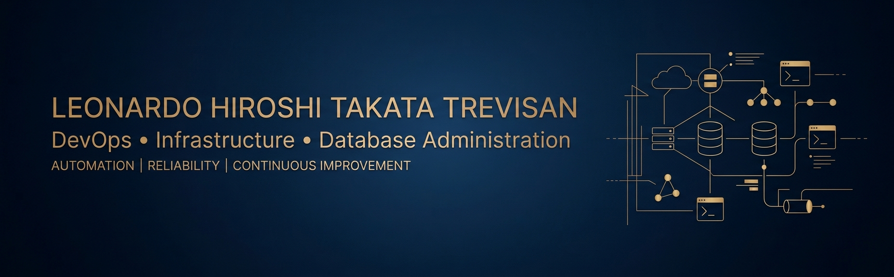

# Leonardo Hiroshi Takata Trevisan

  <strong>DevOps | Infrastructure | Database Administration</strong>

IT professional with experience in database administration, enterprise systems, infrastructure, networking, and software development. Currently expanding my knowledge of DevOps practices, automation, CI/CD, and Infrastructure as Code.

I am passionate about troubleshooting complex technical problems, improving system reliability, and building secure and efficient IT environments.

### Core Areas

- Database Administration — Oracle Database, SQL, PL/SQL, and PostgreSQL
- Enterprise Systems — Oracle E-Business Suite (EBS)
- Infrastructure — Linux administration and network troubleshooting
- Automation — Scripting and operational task automation
- DevOps — CI/CD, containers, Infrastructure as Code, and observability
- Security — Infrastructure security fundamentals and system reliability

### Technologies & Tools

  
  
  
  
  
  
  
  

### Current Focus

- Learning and applying DevOps principles
- Improving infrastructure automation skills
- Exploring CI/CD pipelines and containerization
- Developing practical projects and technical documentation

### Technical Portfolio

This profile will showcase practical projects, scripts, technical documentation, and experiments focused on databases, Linux infrastructure, automation, and DevOps.

---

  <em>Automating operations. Improving reliability. Learning continuously.</em>

